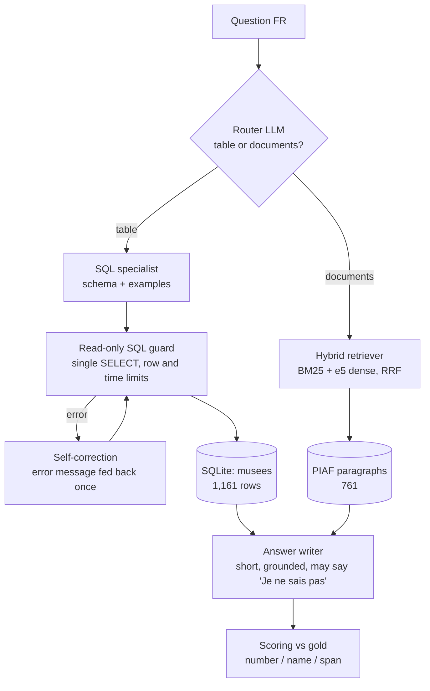

# odagent: a RAG + SQL assistant over French open data, measured

[](https://github.com/Adversitas/opendata-agent/actions/workflows/ci.yml)

Enterprise assistants rarely have one knowledge source. Some questions are answered by
**documents** (retrieve the right passage, read it), others by **structured data** (write a
query, aggregate). This project builds a French-language assistant over two real open datasets
and compares **three architectures** on 120 questions with gold answers, using open-weight LLMs
that run locally (Qwen2.5 1.5B and 3B Instruct on one 8 GB laptop GPU):

| Architecture | How it works |
|---|---|
| `rag-only` | The usual chatbot: always retrieve passages, then answer. |
| `single-agent` | One LLM call picks a tool and writes its input as JSON (`run_sql` with a SELECT, or `search_documents` with a query). The tool runs, a failed SQL statement is sent back once with the error, and a second call writes the answer from the observation. |
| `router+specialists` | Multi-agent: a router classifies the question (table vs documents) and hands it to a **SQL specialist** (schema + examples + one self-correction round) or a **RAG specialist** (hybrid retrieval); an answer writer composes the reply. |

Knowledge sources:

- **Table**: *Fréquentation des musées de France 2018* (Ministère de la Culture, Licence
  Ouverte): 1,161 museums with paid and free admissions, loaded into SQLite with the
  department and region derived from the museum id.
- **Documents**: **PIAF** (Etalab, MIT): 761 French Wikipedia paragraphs and 3,835 questions
  written and answered by volunteers.

## Results

**Evaluation set**: 60 table questions from 6 templates (counts, sums, top-1 and threshold
counts by region or city; gold answers computed with pandas, independently of any SQL) + 60
PIAF questions (seeded sample). An answer is correct if it contains the gold number, the gold
museum name, or a PIAF gold answer (or token F1 ≥ 0.5). Produced by `odagent eval` and `odagent
report` (full tables in [`reports/results.md`](reports/results.md)).

| Model | Architecture | **Accuracy** | Table questions | Document questions | Routing accuracy | LLM calls / question | Tokens / question |
|---|---|---|---|---|---|---|---|
| Qwen2.5-1.5B | rag-only | 0.300 | 0.000 | 0.600 | 0.500 | 1.00 | 749 |
| Qwen2.5-1.5B | single-agent | 0.525 | 0.600 | 0.450 | 0.908 | 2.08 | 871 |
| Qwen2.5-1.5B | router+specialists | 0.633 | 0.833 | 0.433 | 0.867 | 2.78 | 827 |
| Qwen2.5-3B | rag-only | 0.317 | 0.000 | 0.633 | 0.500 | 1.00 | 747 |
| Qwen2.5-3B | single-agent | 0.717 | 0.833 | 0.600 | 1.000 | 2.05 | 898 |
| **Qwen2.5-3B** | **router+specialists** | **0.725** | **0.833** | 0.617 | 0.992 | 2.49 | **766** |

**Retrieval** on all 3,835 PIAF questions (`odagent retrieval`, multilingual-e5-small for the
dense side, RRF fusion):

| Retriever | Recall@1 | Recall@3 | Recall@5 | Recall@10 | MRR@10 |
|---|---|---|---|---|---|
| BM25 (French tokenisation, accent folding, stop words) | 0.671 | 0.802 | 0.839 | 0.881 | 0.744 |
| Dense (multilingual-e5-small) | 0.668 | 0.832 | 0.872 | 0.909 | 0.757 |
| **Hybrid (RRF)** | **0.706** | **0.851** | **0.890** | **0.920** | **0.784** |

What the numbers say:

- **RAG alone cannot answer aggregate questions.** It scores 0 % on the table questions with
  either model. "How many admissions did the museums of Nice record?" needs a `SUM`, not a
  passage. Adding a SQL tool more than doubles overall accuracy (0.32 → 0.73 with the 3B model).
- **With a capable model, single-agent and router+specialists tie** (0.717 vs 0.725, within
  noise on 120 questions). The multi-agent design uses 15 % fewer tokens because each specialist
  sees only its own instructions.
- **With a weaker model, specialisation helps.** At 1.5B the router + SQL specialist answers
  83 % of table questions against 60 % for the single agent, which more often writes a SELECT
  without the `SUM` it needs (it returns the first museum's figure instead of the city total).
- **Routing errors are the cost of a small router.** The 1.5B router sends 13 % of questions to
  the wrong source, and its document accuracy drops to 0.43 (vs 0.60 for RAG-only). The 3B
  router is right 99 % of the time and loses almost nothing on documents.
- **Typical SQL failures are semantic, not syntactic.** After one self-correction round, under
  4 % of queries fail to execute. The remaining errors run fine but are wrong: missing
  aggregation, or an invented filter (e.g. `region = 'Haute-Savoie'`, a department, for
  Chambéry). Execution success is therefore a poor proxy for correctness, which is why the
  gold answers are computed independently.
- **Hybrid retrieval is worth its cost**: +4.9 points recall@3 over BM25 and +1.9 over dense
  alone. Retrieval is not the bottleneck on document questions (88 % of gold passages are in
  the top 3); reading and answering is.

> A harness bug was found and fixed during the evaluation: the prompt's examples label queries
> `SQL: SELECT ...`, models echoed the label, and the read-only guard rejected the statement
> (65 % failures for the router). `clean_sql` now strips the label, a regression test covers
> it, and both SQL-using architectures were re-run; the tables above are from the fixed runs.

## Architecture



| Module | Role |
|---|---|
| `data.py` | Loads the museum CSV (stats parsing, department → region mapping) into SQLite; loads PIAF |
| `questions.py` | Templated table questions with pandas-computed gold; seeded PIAF sample |
| `retrieval.py` | French tokenizer, BM25, multilingual-e5 dense index, reciprocal rank fusion |
| `tools.py` | Read-only SQL runner (SELECT only, no `;`, no DDL/PRAGMA, 20-row cap, 2 s timeout) |
| `agents.py` | The three architectures, batched per step so the local GPU stays busy |
| `llm.py` | Local `transformers` backend with token and latency accounting; fake backend for tests |
| `scoring.py` | French-aware normalisation, number extraction (`45 312`, `45,312`), token F1 |
| `cli.py` | `odagent retrieval / eval / report / ask` |

## How to run

```bash
pip install -e ".[llm,dev]"
odagent retrieval                                   # recall@k, BM25 / dense / hybrid
odagent eval --model Qwen/Qwen2.5-3B-Instruct       # all three architectures, 120 questions
odagent report                                      # rebuilds reports/results.md
odagent ask "Quel musée d'Île-de-France a reçu le plus d'entrées en 2018 ?"
pytest -q && ruff check . && ruff format --check .
```

CI (Python 3.10 and 3.12) runs lint, format and tests (agents exercised end to end with a
scripted fake LLM, including the SQL self-correction path), the BM25 retrieval benchmark on all
PIAF questions, and rebuilds the results tables from the committed per-question outputs.
Full traces of every run (`reports/*/traces_*.jsonl`) are committed for inspection.

## Limitations

- **Routing is easier here than in a real company**: the two sources are on different topics
  (museum statistics vs general knowledge). Overlapping sources would make the router's job,
  and the gap between architectures, larger.
- **120 questions**: differences under ~5 points are within noise. Table questions come from 6
  templates, so they test SQL reliability more than linguistic variety.
- **Lenient answer matching** (gold contained in the answer) can accept a verbose answer that
  happens to contain the right number among others; it was spot-checked, not audited.
- **Small local models only** (1.5B, 3B) to fit an 8 GB GPU; no API model was measured.
- Latency is not compared: the runs shared the machine with other jobs.
- The museum table is the 2018 edition; later years exist but were not integrated.

## En bref (FR)

Assistant en français qui combine **RAG** (paragraphes Wikipédia du jeu PIAF, recherche hybride
BM25 + e5, recall@3 de 0,85) et **text-to-SQL** (fréquentation 2018 des musées de France,
SQLite en lecture seule avec auto-correction). Trois architectures sont comparées sur 120
questions avec réponses de référence, avec des LLM open source exécutés en local (Qwen2.5 1,5B
et 3B) : RAG seul (0,32 : incapable de répondre aux questions d'agrégation), agent unique avec
outils (0,72) et **routeur + agents spécialisés (0,725, 15 % de tokens en moins)**. Avec le
petit modèle, la spécialisation fait la différence sur les questions SQL (83 % contre 60 %).
Les erreurs SQL restantes sont sémantiques (agrégation oubliée, filtre inventé) et non
syntaxiques : une requête qui s'exécute n'est pas une requête juste.

## License

MIT (code). Data: *Fréquentation des musées de France* (Licence Ouverte / Etalab 2.0),
PIAF (MIT). Qwen2.5 models: Apache-2.0 (1.5B), Qwen Research License (3B).
